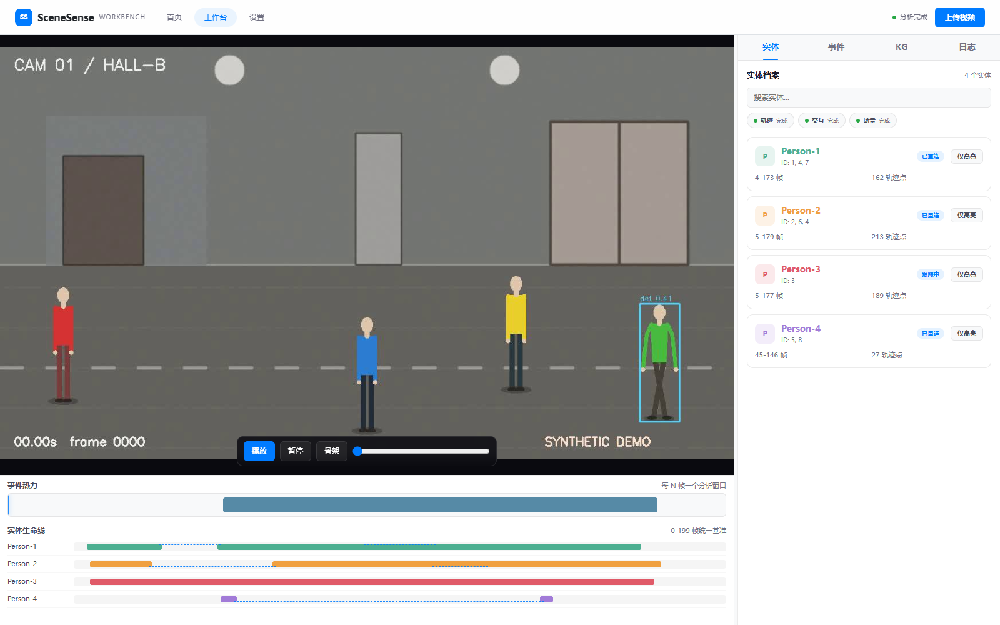
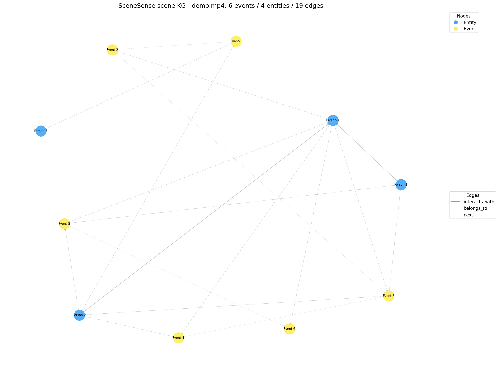

# SceneSense

单相机监控视频 → 逐帧轨迹 → 时空事件 → 场景知识图谱 → 中文场景报告。

| Web 工作台 | 事件时间线 |
| --- | --- |
|  |  |



截图来自仓库自带的合成示例视频（几何人形，不含人像），未做手工修饰。这段 8 秒 / 200 帧的示例跑完得到
**6 个事件、4 个 Entity、10 个节点 / 19 条边**。

## 它做什么

SceneSense 把监控回看从「拖进度条找那一段」变成「查图」：输入一段单相机视频（文件 / 摄像头 / 图片序列），
逐帧检测并跟踪行人，输出带 `track_id` 的轨迹。断裂的 tracklet 按位置、时间、外观合并成稳定 Entity；
每 30 帧切一个时空事件，交给分析 Agent 产出运动模式、交互与场景总述，可选异常评分。事件与实体写入知识图谱，
可导出 GraphML，也可用自然语言查询。感知、事件、图谱三层都能本地跑，只有交互判断在规则不确定时调用一次 LLM。

## 快速开始

```bash
git clone https://github.com/zhangjingtong000/SceneSense.git
cd SceneSense
python -m venv .venv
.venv\Scripts\activate        # macOS / Linux: source .venv/bin/activate
pip install -r requirements.txt

# 仓库自带合成示例，不需要 API Key 或外部素材
python pipeline.py --source assets/demo/sample.mp4 --dry-run --annotate --annotate-path outputs/demo.mp4
```

`--source 0` 接摄像头，`--source path/to/frames/` 接图片序列。`--dry-run` 只跑检测 / 跟踪 / 事件 / KG。
完整链路先 `set DEEPSEEK_API_KEY=sk-...`（Linux/macOS 用 `export`），再去掉 `--dry-run`。

Web 工作台（可选）：

```bash
pip install "fastapi>=0.110" "uvicorn[standard]>=0.27" python-multipart
python -m uvicorn web.backend.main:app --port 8000
```

打开 `http://127.0.0.1:8000`。Web 端用 `yolov8l.pt`（87 MB，首次运行自动下载）、60 帧事件窗口、
关闭 GMC 优先出帧速度；CLI 默认 `yolov8n-pose.pt`、30 帧窗口、开启 GMC。

## 功能

| 能力 | 说明 | 状态 |
| --- | --- | --- |
| 检测与姿态 | YOLOv8 检测 + YOLOv8-pose 17 个 COCO 关键点，两阶段解耦 | 稳定 |
| 多目标跟踪 | GMC 稀疏光流 + 8 状态卡尔曼 + OSNet ReID + 匈牙利匹配 | 稳定 |
| 实体合并 | 位置 / 时间 / 外观三项打分，跨 tracklet 续接身份 | 稳定 |
| 时空事件 | 默认 30 帧一个窗口，输出轨迹、空间近邻与场景类型 | 稳定 |
| 分析 Agent | 轨迹、交互、总结、异常四个 Agent，规则为主；异常 Agent 可选 | 稳定 |
| 知识图谱 | NetworkX DiGraph，`belongs_to` / `interacts_with` / `next`，GraphML 存取 | 稳定 |
| 规则引擎 | 3 条内置规则（徘徊 / 奔跑 / 静止），`--with-rules` 接入 | 可用 |
| Web 工作台 | 上传视频、实时进度、事件 / KG / 日志页签、实体生命周期图 | 可用 |
| MOT 指标 | IDF1 / MOTA / HOTA 适配器，需自备数据集与后端 | 可用 |
| 跨相机 ReID、实时流 | 当前只做单相机离线回看，Web 用 WebSocket 推进度 | 未实现 |

四个 Agent 里只有 `interaction_agent` 会调 LLM：规则置信度 < 0.60 时调一次，且只在 LLM 置信度更高时覆盖规则结论。
`trajectory_agent` 是纯规则 / 分位数，`summary_agent` 是字符串模板，`anomaly_agent` 是关键词模板打分。
`/chat` 的规则模板匹配不上时才走 LLM 兜底。

## 设计要点

- **实体合并看三项证据**：0.35 位置 + 0.30 时间 + 0.35 外观；≥0.72 自动合并，0.30–0.72 记为 tentative 候选。
  外观余弦 > 0.90 时允许突破 300 帧 gap；位置分取最后位置与按速度外推位置中更近者。
- **事件窗口**：CLI 每 30 帧切一个 `SpatioTemporalEvent`，按 `track_id` 去重保留轨迹最全的一条，计算 100 像素内的
  `near` 关系（Web 端窗口 60 帧）；后 20 帧凑不满一个窗口时不补短事件。事件既是 Agent 的输入粒度，也是 KG 的 Event 节点来源。
- **规则引擎**：按 `zone_type`、`motion_profile`、速度区间、停留时长、方向变化逐实体检查，内置徘徊 > 60 秒、
  奔跑、静止 > 120 秒三条；`--with-rules` 在 Agent 写完后运行，命中挂在 `rule_hits`。
- **GMC 不是可选项**：相邻帧稀疏光流 + RANSAC 仿射，先减掉背景整体位移再更新卡尔曼；没有它，手持或云台视频里
  静止的人会被算成高速移动。组合距离里外观只做候选内区分，避免同款工服的人串号。

编排是单轮星型：默认 `trajectory → interaction → summary`，`--with-anomaly` 把异常 Agent 插到总结之前。
配置常量、阈值来源与取舍推导见 [docs/architecture.md](docs/architecture.md)。

## 已知边界

- MOT17 实测只覆盖每个序列前 298 帧（帧覆盖率 28%–57%），IDF1 / MOTA / HOTA 不代表完整序列性能；
  口径、逐序列数字与复现命令见 [docs/evaluation.md](docs/evaluation.md)。
- OSNet 权重 `osnet_x0_25_msmt17.pt` 不随仓库分发，需自备放入 `models/`；缺失时回退 ResNet18，遮挡后 ID 连续性下降。
- `ultralytics` 与 `boxmot` 是 AGPL-3.0：组合分发或作为网络服务提供时整体受 AGPL 约束；闭源商用需替换或取得授权。
- 单相机、离线：不做跨镜头 ReID，也不做实时 WebRTC；多路视频各自建图，跨点位查询需人工对齐。
- 无相机标定时，`velocity_ms` 实际是像素/秒、`distance_m` 是像素，字段名沿用早期约定。

## 目录结构

```text
agents/            四个分析 Agent、Orchestrator、LLM 客户端
assets/demo/       合成示例视频（1280×720 / 25fps / 8s）
docs/              架构、评估与截图
evaluation/        MOT 指标适配器、Demo 序列、Gate 评估
kg/                GraphStore、连续性写入、规则引擎
models/            ReID 权重放这里（可选，不入库）
perception/        检测、跟踪、实体画像、事件构建
scripts/           Gate 入口、MOT 序列导出、KG 可视化
tests/             162 个测试
web/               FastAPI 后端 + 原生 HTML/JS 前端
pipeline.py        端到端入口
```

## 测试

```bash
pip install -r requirements-dev.txt   # 运行依赖 + 测试依赖（httpx / motmetrics / trackeval / pytest / ruff）
python -m pytest -q        # 162 passed
python -m ruff check --select F,E9 .
```

`requirements.txt` 只装运行所需；`requirements-dev.txt` 已通过 `-r requirements.txt` 带上前者，
并补上 `tests/web/` 需要的 `httpx` 与 `tests/evaluation/` 断言必须有的 `motmetrics` / `trackeval`。
CI 在 Python 3.10 / 3.12 上跑同样的检查，见 `.github/workflows/ci.yml`。MOT 指标回归：

```bash
python -m evaluation.mot_metrics --gt evaluation/demo_data/gt.txt --pred evaluation/demo_data/idsw.txt
```

## 许可

自身代码 MIT，见 [LICENSE](LICENSE)。依赖的 `ultralytics` 与 `boxmot` 是 AGPL-3.0：把本项目与它们共同分发，
或作为网络服务提供时，整体受 AGPL-3.0 约束；闭源商用需替换检测 / ReID 实现或取得商业授权。
逐项清单与替代方案见 [THIRD-PARTY.md](THIRD-PARTY.md)。
