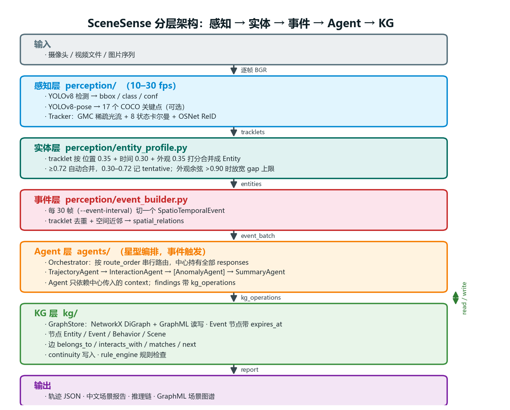
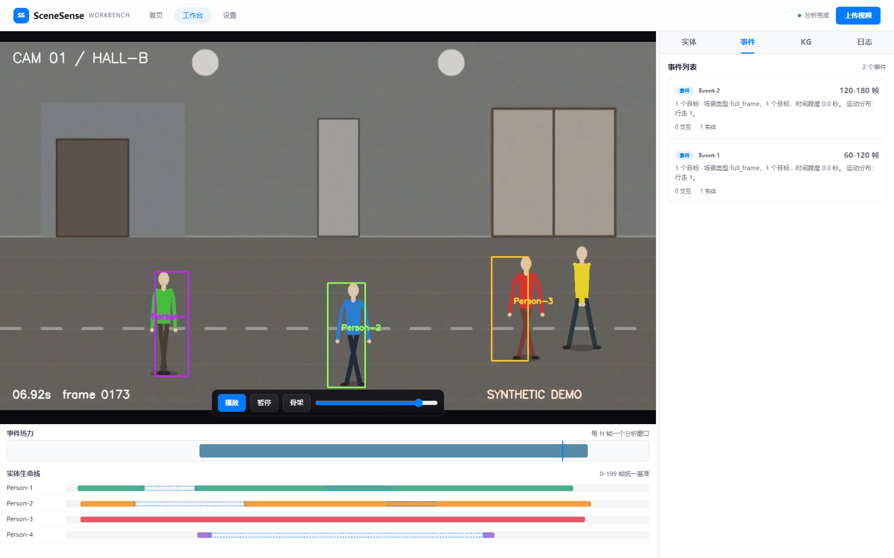

# SceneSense
输入一段监控视频（文件 / 摄像头 / 图片序列），输出带 `track_id` 的逐帧轨迹、每 30 帧切出的时空事件、中文场景报告，以及一份可用 GraphML 打开、可问答的场景知识图谱。

> ## ⚠️ 许可证：自身 MIT，但与 AGPL-3.0 依赖组合后整体受 AGPL 约束
>
> 本项目**自身代码**（`perception/`、`agents/`、`kg/`、`web/`、`pipeline.py`）以 **MIT** 发布，见 [LICENSE](LICENSE)。
> 但依赖的 **`ultralytics`（YOLOv8）与 `boxmot` 采用 AGPL-3.0**。因此把本项目与这些依赖
> **组合分发**、或**作为网络服务提供**时，整体受 **AGPL-3.0** 约束（需提供整体源码，
> 网络服务用户有权获取对应源码）。
> **如需闭源商用**，需替换检测 / ReID 实现，或向 Ultralytics 与 boxmot 作者取得商业授权。
> 完整的依赖与许可清单见 [THIRD-PARTY.md](THIRD-PARTY.md)。



> 上图是感知层 → 实体层 → 事件层 → Agent 层 → KG 层的分层与数据流。Mermaid 源仍在 [`docs/architecture.md`](docs/architecture.md)（三段：整体架构 / 时序 / KG Schema）；重绘这张 PNG 用 `python docs/gen_architecture_png.py docs/architecture.png`（matplotlib，不依赖 Node）。

## 跑起来长什么样

| Web 工作台（上传 `assets/demo/sample.mp4` 跑完后） | 事件时间线（事件热力 + 实体生命线） |
| --- | --- |
|  |  |


- 前两张是真实运行截图：`python -m uvicorn web.backend.main:app --port 8000` 起服务，上传仓库自带的合成示例视频，等进度到 100% 后截的。左边是标注视频 + 实体档案，右边可切「事件 / KG / 日志」页签；下方是事件热力条与每个实体的生命线（虚线缺口＝该帧没检到）。
- 第三张是**同一段示例视频**走 CLI 全链路（`--dry-run --event-interval 30`）后导出的 GraphML，再用 `python scripts/visualize_kg.py --kg <graphml> --output kg.png` 渲染：6 个 Event + 4 个 Entity、19 条边（`belongs_to` / `interacts_with` / `next`），和下面「这段示例视频跑出来的实际数字」是同一组结果，未做手工修饰。
- 素材本身是**合成画面**（几何人形，无人像），所以截图里看起来像简笔画——那是素材，不是渲染问题。

## 它解决什么问题

监控视频的日常用法是"事后找那一段"：谁在几点进了哪个区域、和谁待了多久、有没有异常。逐帧检测器回答不了——它每帧独立，人一被遮挡就换 ID，事件之间也串不起来。SceneSense 把检测结果往上收成三层：稳定的 Entity（身份）、时间窗内的 Event（发生了什么）、可查询的图（怎么关联），回看视频变成查图。

## 怎么做的

### 1. 感知：检测 + 姿态

YOLOv8 出 bbox / 类别 / 置信度，YOLOv8-pose 单独出 17 个 COCO 关键点，作为可选信号注入轨迹。两阶段解耦：换检测模型不影响姿态，关掉姿态也不影响跟踪。

### 2. 跟踪 `perception/tracker.py`

BoT-SORT 式结构，四个部件各解决一件事：

- **GMC**：相邻帧稀疏光流（`goodFeaturesToTrack` → `calcOpticalFlowPyrLK` → RANSAC 求 2×3 仿射），先减掉背景整体位移再更新卡尔曼状态。没有这一步，手持或云台视频里静止的人会被算成高速移动。
- **卡尔曼**：8 状态 `(cx, cy, w, h, vx, vy, vw, vh)`，4 维观测；轨迹丢失期间靠它预测位置。
- **ReID**：OSNet x0.25（MSMT17 预训练）出 512 维 L2 归一化特征。BoxMOT 与 torchreid 两条 OSNet 链路，都不可用时回退 ImageNet ResNet18，此时 ID 连续性明显变差。
- **组合距离**：先算 `1 - IoU`，再用 IoU 门控外观——IoU 低于 0.5 的配对不看外观，外观余弦距离大于 0.25 直接置 1，两者取 `min` 作为匈牙利代价。

**为什么遮挡必须上 ReID**：人被挡住时 IoU 会掉到 0，纯 IoU 在这类帧上无解，只能新建 ID，遮挡结束就变成"两个人"。但只用外观也不行——同款工服、相似身高的人会互相串号。所以这里先用 IoU 圈出位置还说得过去的候选，再让外观在候选内部做区分，而不是让外观全局找人。

**低分框阶段故意不用外观**：遮挡后重现的人往往只剩低分检测，代码第二阶段只用 IoU（阈值 0.5）。跟踪器注释记录了实测结论——这一阶段放外观会引入错误关联，恢复率反而下降。lost 轨迹缓冲 120 帧后才丢弃。

### 3. 实体 `perception/entity_profile.py`

tracklet 会断，Entity 不该断。按 0.35 位置 + 0.30 时间 + 0.35 外观加权打分：≥0.72 自动合并，0.30–0.72 记为 tentative 候选并逐帧累积证据。外观余弦 >0.90 时允许突破 300 帧的 gap 上限，用于长时间被立柱、货架遮住再出现的人。位置分取"最后位置"和"按速度外推位置"中更近的那个；`pipeline.py` 启动时还会把位置门限抬到画面宽的 40%，否则 1920 画面里跨几秒遮挡的位移会被判成新实体。

### 4. 事件 `perception/event_builder.py`

每 30 帧（`--event-interval`；Web 后台固定 60 帧，见「Web 演示」）切一个 `SpatioTemporalEvent`：tracklet 按 `track_id` 去重、保留轨迹最全的一条，计算空间近邻关系后交给 Agent 层。事件既是 Agent 的输入粒度，也是 KG 里 Event 节点的来源。

### 5. 编排 `agents/orchestrator.py`：星型

中心节点按 `trajectory → interaction → summary` 串行路由，每一步把前序所有 Agent 的 findings 塞进下一步上下文；结束后由中心统一收集 `kg_operations` 写入 GraphStore。**为什么不是链式**：链式 A→B→C 里 C 只能看到 B 的输出，想加第四个分析维度就得改链路；星型中心自己持有全部 `responses`，Agent 只依赖中心传进来的 context，因此可以单独替换或追加（`anomaly_agent.py` 就是这样独立写出来的，不碰路由代码），`reasoning_trail` 也能完整记下每个 Agent 的输入摘要和产出。

**四个 Agent 怎么选**：默认路由仍是三个（`trajectory → interaction → summary`）；`python pipeline.py --with-anomaly …` 会把 `anomaly_agent` 按 `position=2` 插进 `Orchestrator.route_order`，形成 `trajectory → interaction → anomaly → summary`——异常评分先产出，总结阶段就能读到它。开关只动注册与路由顺序，四个 Agent 的内部逻辑一行没改。

### 6. 四个 Agent

| Agent | 职责 | 关键取舍 |
| --- | --- | --- |
| `trajectory_agent` | 个体运动模式 | 纯规则：速度先除以人体框高度做尺度归一化，再按场景分位数分 stationary/slow/normal/fast/running，不调模型 |
| `interaction_agent` | 两两交互 | 轨迹按跳变点切段后做时间对齐，提取距离均值/方差、轨迹余弦、共现时长，分成结伴同行 / 面对面交谈 / 短暂接触 / 无交互；几何规则置信度 < 0.60 时才调一次 LLM 精判 |
| `summary_agent` | 场景总述 | 只吃前两者的结构化 findings，不重新看原始轨迹；输出是字符串模板拼接，不调模型 |
| `anomaly_agent` | 异常行为 | 拿 Behavior 模板的关键词集合与轨迹/交互特征打分，只输出 `raw_score`，最终严重度留给协调层融合；不调模型 |

**Agent 层的 LLM 实际参与度**（别按「四个 Agent 都在调模型」理解）：

- 主流程里唯一会触发 LLM 的是 `interaction_agent`：规则算出的置信度 `< 0.60` 时调一次 `chat_with_json_output` 精判交互类型，且只有 LLM 置信度更高时才覆盖规则结论。这次调用的 system prompt 来自 `agents/prompts/interaction.md`，是全仓唯一真正送进模型的 prompt 文件。
- `trajectory_agent` 是纯规则/分位数；`summary_agent` 是纯字符串模板；`anomaly_agent` 是关键词集合打分。这三个都不调模型，因此也没有 system prompt。
- 早前 `trajectory_agent._llm_refine()`、`agents/prompts/` 下另外四个 md、以及 `vlm_client.py` / `doubao_vlm_client.py` 都属于「写了但没接线」的死代码，已删除。
- 另一处活跃的 LLM 入口是 `/chat` 的兜底：规则模板匹配不上时才把实体摘要发给 LLM；前端确认合并发的 `__merge__` 指令不调模型。

### 7. 知识图谱 `kg/`

- `graph_store.py`：NetworkX DiGraph。属性统一 JSON 编解码，支持 upsert、子图、VF2 子图匹配、GraphML 存取；Event 节点带 `expires_at`，可按时间批量淘汰。
- `continuity.py`：写 Event / Entity 节点和 `belongs_to`、`interacts_with`、`next` 边。同一对实体的交互边按事件聚合，保留最近 20 条证据，`confidence = min(1, 事件数 / 5)`，`duration` 由证据累加。
- `rule_engine.py`：按 `zone_type`、速度区间、停留时长、方向变化逐实体检查。
  **已接入管线**：`pipeline.py --with-rules` 会在 Agent 写完之后调用 `RuleEngine.check_all()`，
  命中结果挂在 `output["rule_hits"]` 上并打印。内置 3 条规则（`kg/rule_engine.py::default_rules()`）：
  徘徊超 60 秒、奔跑、静止超 120 秒。这些规则依赖 Entity 节点的 `motion_profile` / `velocity` /
  `direction_change_count` / `first_seen` / `class` 字段，`trajectory_agent` 现在会把它们写进去
  ——之前没写，所以引擎即使被调用也一条都匹配不上。
  （早前的 `kg_builder.py`（LLM 生成 Behavior 模板）从未接线、字段也对不上，已删除；
  `anomaly_agent` 用的是内置模板表 `BEHAVIOR_TEMPLATES`。）

## 前置要求

**Python 3.10+**，`pip install -r requirements.txt`。Web 演示那一段在 `requirements.txt` 里默认
注释着，要跑 `uvicorn` 得先取消注释再装。

**模型权重**：

| 权重 | 放哪 / 怎么来 | 缺失的后果 |
|---|---|---|
| `yolov8n-pose.pt`（检测 + 姿态） | 首次运行时 Ultralytics 自动下载 | 跑不起来（必需） |
| `yolov8l.pt`（Web 端检测，约 87 MB） | Web 后端硬编码用它（`web/backend/pipeline_runner.py`），不在仓库里 | 不起 Web 演示；CLI 不用它 |
| `osnet_x0_25_msmt17.pt`（ReID 特征，512 维） | 手动放到 `models/`；**默认路径会优先读它**（`ReIDExtractor` 检测到文件就走 torchreid 本地链路），没有时才交给 BoxMOT 自动管理 | 回退 BoxMOT → 再回退 ImageNet ResNet18：ID 连续性明显变差，交叉遮挡后更容易换 ID。日志会打印 `[ReID] BoxMOT 不可用（…），回退 ResNet18` 或 `[ReID] 自实现 OSNet 不可用（…）`，看到这两行就说明正在用回退链路 |

OSNet 权重不随仓库分发：它按 MSMT17 训练，而 MSMT17 的图像有使用限制，权重再分发同样受限；
文件本身也不小。要精确的 ID 连续性就把权重放进 `models/`（放进去即生效，不需要改配置或传
`backbone=osnet_fast`——早前那条「只在 `osnet_fast` 分支读 `models/`」的路径没有任何入口能走到，
现在默认路径会自己切过去），只是看看效果则回退版也能跑完。BoxMOT 那条路会去 Google Drive 拉权重，
网络不通时通常表现为长时间卡住后回退 ResNet18。

**API Key**：Agent 层是在线 LLM（DeepSeek），需 `set DEEPSEEK_API_KEY=sk-...`。实际只有交互分析
Agent 在规则置信度 `< 0.60` 时调一次（见第 6 节的 LLM 参与度），其余三个 Agent 是规则/模板。
`/chat` 的兜底也会用到它。
不需要它时用 `--dry-run`，只跑检测 / 跟踪 / 事件 / KG，不碰网络。

**数据集**：MOT17 不随仓库分发（许可 + 体积：train 集图像以 GB 计）。要跑标准 MOT 指标得自备，
把 `gt.txt` 和导出的预测文件喂给适配器；仓库自带的 200 帧合成序列（`evaluation/demo_data/`，219 KB）
clone 下来即可验证指标链路。

## 快速开始

```bash
git clone <repo-url> scenesense && cd scenesense
python -m venv .venv
.venv\Scripts\activate            # Windows；Linux/macOS: source .venv/bin/activate
pip install -r requirements.txt
```

**权重**：`yolov8n-pose.pt` 开箱自动下载；想要稳定的 OSNet 特征，把 `osnet_x0_25_msmt17.pt`
放进 `models/` 即可（默认 ReID 路径优先读这个文件，见「前置要求」的表）。

**示例视频（不需要自备素材）**：`assets/demo/sample.mp4` 是仓库自带的**合成监控素材**（1280×720 / 25fps / 8s / 1.3 MB），4 个几何绘制的行人，包含交叉遮挡、一人在画面中部低速徘徊、一人走出画面再回来。**不是真实监控画面，也不含任何人像。**

```bash
python pipeline.py --source assets/demo/sample.mp4 --dry-run --annotate --annotate-path outputs/demo.mp4
```

**跑通感知层（不需要 API Key）**：

```bash
python pipeline.py --source your_video.mp4 --dry-run --annotate --annotate-path outputs/demo_annotated.mp4
```

`--source 0` 接摄像头，`--source path/to/frames/` 接图片序列目录；`--dry-run` 只跑检测/跟踪/事件/KG，跳过 LLM。

**单位**：没有相机标定时，产物里的 `velocity_ms` 实际是**像素/秒**、`distance_m` 实际是**像素**（字段名沿用早期设想，未改名，避免破坏 Web/Agent 的字段契约）。dry-run 日志按 `vel=…px/s`、`dist=…px` 打印，`EventBuilder` 的近邻阈值 100 也是像素；接上相机标定后才有物理单位。

**这段示例视频跑出来的实际数字**（`--event-interval` 默认 30 帧；2026-11-27 在 CUDA 上按下面的命令重跑，复现了同一组数）：8 秒切出 **6 个事件**；事件里出现过的 `track_id` 共 **7 个（2/3/5/7/8/9/11）**，`raw_tracks=12`，最终收敛成 **4 个 Entity**；每个事件内 1–3 个 tracklet、最多 1 条 `near` 空间关系；结束时 KG 有 **10 个节点（6 Event + 4 Entity）/ 19 条边**；`tracker metrics: drop_rate=0.0838 gap_rate=0.0479 id_switches=8 entities=4`。

> **两个比率的口径**（容易对不上）：`0.0838 / 0.0479` 是**全片 200 帧**的累计口径，就是运行时最后打印的那一行。
> 事件产物里每个事件存的是**截至该窗口末尾**的快照，最后一个事件只累计到 180 帧，那里是 `0.0917 / 0.0541`。
> 同一份运行、两种分母，不是两套结果。后 20 帧凑不满一个 30 帧窗口，所以只有 6 个事件、`frame_count=180`。

`id_switches=8` 偏高是这类合成素材的预期表现——纯色人形在交叉重叠和出画时外观特征几乎不可分，ReID 本来就该失败，这正是下面"遮挡必须上 ReID"那段要解决的问题；换真实监控素材会明显好转。

**带 Agent 的完整链路**：

```bash
set DEEPSEEK_API_KEY=sk-...        # Linux/macOS: export DEEPSEEK_API_KEY=...
python pipeline.py --source your_video.mp4 --model yolov8n-pose.pt \
  --output outputs/results.json --kg-path outputs/scene.graphml

# 额外接上异常检测 Agent（路由变成 trajectory → interaction → anomaly → summary）
python pipeline.py --source your_video.mp4 --with-anomaly \
  --output outputs/results.json --kg-path outputs/scene.graphml
```

**Web 演示**：前端在 `web/frontend/`（原生 HTML/JS，无构建链），后端在 `web/backend/`。
先取消 `requirements.txt` 里 Web 段的注释并安装，然后 `python -m uvicorn web.backend.main:app --port 8000`，
打开 `http://127.0.0.1:8000`。

Web 端和 CLI 的默认值**不一样**，看代码前先知道这几条（都是为交互流畅做的取舍，不影响 CLI）：

| 项 | Web | CLI |
|---|---|---|
| 检测权重 | 硬编码 `yolov8l.pt`（87 MB，不在仓库里，首次运行由 Ultralytics 下载或手动放到根目录），`imgsz=960`、`conf=0.15`、只跑 `classes=[0]`（person） | `yolov8n-pose.pt`、`imgsz=640`、`conf=0.5`，可用 `--classes 0,2` 加类别 |
| 事件窗口 | `event_interval_frames=60` | `--event-interval` 默认 30 |
| GMC | `with_gmc=False`（省掉每帧光流，优先出帧速度） | 默认开启 |

`/chat` 问答接口在 `web/backend/main.py`，实现是 `scripts/qa_repl.py::KGQA`：先按「N号在干什么 / A号和B号什么关系 / 场景里有多少人 / 谁在跑动 / N号附近有谁」的模板查 KG，匹配不上才用 `DEEPSEEK_API_KEY` 兜底；没有 key 时只走规则模板。实体编号两种前缀都认（`Person-3` 与旧的 `Entity-3`）。前端「待确认合并」按钮会往 `/chat` 发一条 `__merge__`，合并只在前端本地状态完成，后端不落库。

## 指标怎么用（MOT）

`evaluation/mot_metrics.py` 按 MOTChallenge 口径算 IDF1 / MOTA / IDP / IDR / FP / FN / IDSW（py-motmetrics）与 HOTA / DetA / AssA（TrackEval）。输入是两个文件：`gt.txt` 是 `frame,id,x,y,w,h,mark,class,visibility`（1 基帧号），预测是 `frame,id,x,y,w,h,conf`（0 基帧号）或 `scripts/export_predictions.py` 导出的 JSONL，坐标都是左上角 + 宽高。`--gt-frame-offset -1` 是默认值，正好把 MOT17 的 1 基 GT 对到 0 基预测，数据文件不是这套约定时才需要改。两个后端各自可选：`pip install motmetrics` 给 IDF1 / MOTA，`pip install --no-deps trackeval` 给 HOTA；缺哪个，对应字段就是 `None` 并在 `backends` 里写明原因，另一个照常算。

下面分两层：**真实序列实测**给出真实量级的数字，**合成数据回归**证明指标有判别力。

### 真实序列实测（MOT17 train，7 个序列）

**先看前提：这批数字不是在完整序列上跑的。**

> **口径**：预测来自 **`yolov8l.engine` / `imgsz=1920` / `conf=0.15` / `reid_interval=3`** 的一次外部批处理运行
> （仓库外的实验目录里的 `MOT17-*-FRCNN.base.jsonl`，同目录 `.meta.json` 记录 `frames=300`；**这批产物不入库**）。
> **每个序列只跑到 frame 299（前 298 帧）**，而 MOT17-02 / 04 / 05 的 GT 分别有 600 / 1050 / 837 帧，
> 七个序列的帧覆盖率是 **28%–57%**。因此预测框只有 **28,129** 个，GT 有 **112,297** 个——预测是 GT 的 **25.0%**。
> 这批文件**不是** `scripts/run_mot_sequences.py` 导出的：那条命令写的是 `<seq>.pred.jsonl`
> 并使用 `yolov8l.pt`，与这里 `.base.jsonl` / `.engine` 的来源和参数都不是一回事。

| 序列 | 帧数 | GT 框 | IDF1 | MOTA | HOTA | IDP | IDR | FP | FN | IDSW |
| --- | --- | --- | --- | --- | --- | --- | --- | --- | --- | --- |
| MOT17-02 | 600 | 18581 | 0.2626 | 0.1271 | 0.2125 | 0.769 | 0.158 | 725 | 15482 | 12 |
| MOT17-04 | 1050 | 47557 | 0.2775 | 0.1491 | 0.2085 | 0.824 | 0.167 | 1261 | 39189 | 15 |
| MOT17-05 | 837 | 6917 | 0.1269 | **-0.0387** | 0.1601 | 0.370 | 0.077 | 841 | 6324 | 20 |
| MOT17-09 | 525 | 5325 | 0.3933 | 0.2368 | 0.2972 | 0.567 | 0.301 | 774 | 3268 | 22 |
| MOT17-10 | 654 | 12839 | 0.2688 | 0.0822 | 0.2171 | 0.515 | 0.182 | 1716 | 10015 | 53 |
| MOT17-11 | 900 | 9436 | 0.3131 | 0.1417 | 0.2771 | 0.685 | 0.203 | 728 | 7368 | 3 |
| MOT17-13 | 750 | 11642 | 0.2139 | 0.0429 | 0.2048 | 0.512 | 0.135 | 1279 | 9846 | 18 |
| 按 GT 框加权 | 5316 | 112297 | 0.2667 | 0.1188 | 0.2168 | 0.695 | 0.168 | 7324 | 91492 | 143 |

三点必须说清：

- **这是逐序列单独算的结果，不是官方 MOTChallenge 提交成绩。** 官方用多序列聚合、以 test 集为准（test 集不公开 GT），这里只是把适配器在真实数据上跑通并给量级。
- **召回低的主因是序列被截断，不能直接归因于检测器/跟踪器能力。** IDR 0.17、FN 91,492 看着像「跟踪器很差」，但预测只覆盖了 GT 框的 25%（帧覆盖 28%–57%），GT 里大半框所在的帧根本没有预测——**IDR 的上限先被覆盖率封顶**，任何跟踪器在这份数据上都拿不到高召回。IDP 0.70 说明「已经预测出来的框里精度尚可」；MOT17-05 的 MOTA 为负，是因为 841 个 FP 相对 6917 个 GT 太多（MOTA 本就可以为负）。**这组数字能证明「适配器在真实数据上跑通」，不能证明「跟踪器的召回能力只有 0.17」。**
- 这组数字和下面合成数据的 1.0 放在一起，只能说明「真实数据 + 覆盖不全时指标会很难看」；它**不是**一份可对标的成绩，也不能拿 0.17 当性能结论引用。

**要得到有意义的数字，需要同时满足：**

1. **跑完整序列**：把整个 `img1/` 喂进跟踪器，而不是先截成 300 帧视频（`run_mot_sequences.py` 默认 `--max-frames 0` 就是全序列）；
2. **用仓库默认命令**：`scripts/run_mot_sequences.py --root MOT17/train --pattern "MOT17-*-FRCNN" --limit 7`（导出 `<seq>.pred.jsonl`）；
3. **GT 全量参与**：`evaluation/mot_metrics.py` 用完整 `gt/gt.txt`，帧号按默认 `--gt-frame-offset -1` 对齐；
4. **把参数记进产物**：模型、`imgsz`、`conf`、`reid_interval`、帧范围写进 meta，否则下次还是没法判断数字能不能用。

复现需要 GPU 和 MOT17 数据集（预测文件不入库：实验产物 + 体积）：

```bash
python scripts/run_mot_sequences.py --root MOT17/train --pattern "MOT17-*-FRCNN" --limit 7
python -m evaluation.mot_metrics \
  --gt MOT17/train/MOT17-04-FRCNN/gt/gt.txt \
  --pred outputs/mot_sequences/MOT17-04-FRCNN.pred.jsonl
```

### 合成数据回归（`evaluation/demo_data/`）

这层不关心真实性能，只管指标算得对不对。`evaluation/demo_data/` 是 200 帧 / 6 目标 / 1200 个 GT 框的**合成**序列（由 `evaluation/make_demo_sequence.py` 生成，219 KB），clone 下来就能跑：

```bash
python -m evaluation.mot_metrics \
  --gt evaluation/demo_data/gt.txt \
  --pred evaluation/demo_data/idsw.txt --out outputs/mot/idsw.json
```

输出：

```text
IDF1=0.825  MOTA=0.9967  HOTA=0.8723  (DetA=1.0  AssA=0.7608)
IDP=0.825  IDR=0.825  FP=0  FN=0  IDSW=4
GT 框=1200  预测框=1200  帧数=200  IoU 阈值=0.5
后端: {'mota_idf1': 'motmetrics 1.4.0', 'hota': 'trackeval 1.3.0'}
```

三个预测文件取自**同一份 GT**，差别只在跟踪错误，所以数字的差异就是指标在反映这些错误：

| 预测文件 | 造了什么错 | IDF1 | MOTA | HOTA | IDSW | FN | FP |
| --- | --- | --- | --- | --- | --- | --- | --- |
| `perfect.txt` | 无，与 GT 逐框一致 | 1.000 | 1.000 | 1.000 | 0 | 0 | 0 |
| `idsw.txt` | 2、4 号各换 1 次 ID，6 号换 2 次 | 0.825 | 0.9967 | 0.8723 | 4 | 0 | 0 |
| `dropout.txt` | 1 号漏 30 帧、5 号漏 50 帧、3 号每 7 帧漏 1 帧 | 0.9524 | 0.9092 | 0.8651 | 0 | 109 | 0 |

读法：

- `idsw.txt` 的框一个没错，`FP` / `FN` 都是 0，但 `IDF1` 从 1.0 掉到 0.825、`IDSW` 计到 4——这正是 ID 跳变对关联指标的惩罚。
- `dropout.txt` 没有换 ID（`IDSW=0`），但 `FN` 到 109、`IDR` 掉到 0.9092——漏检只伤召回。
- `HOTA` 两种错误都会压：`idsw` 的 `AssA=0.7608`，`dropout` 的 `DetA=0.8597`。

**这一层是合成数据的演示，只证明适配器能把「好」和「坏」分开**（`tests/evaluation/test_mot_metrics.py::TestDemoSequence` 把这些关系固化成断言，指标算错会让测试红），不代表任何真实跟踪性能——真实数字看上面那张 MOT17 表。

重新生成演示数据（`--report` 顺带打印上表）：

```bash
python -m evaluation.make_demo_sequence --report
```

改了生成器要重跑这一步——`TestDemoSequence` 会检查 `demo_data/` 与生成器输出逐字节一致。

### 自建 gate 与标准指标的分工

适配器之外还有一套自建 gate 体系，判的是「这次跟踪能不能用」，不与 MOTChallenge 的成绩可比：
帧级召回 / 精度（各 0.90 门槛）、人物发现率、最长连续漏检（10 帧）、错误合并次数、碎片数。
`recovery_rate` 由 GT 的 `person_id` 在可见帧断口处**自动计算，无需人工标注**
（`compute_recovery_rates`），分 0–2 秒 / 2–10 秒 / >10 秒三档，`run_evaluation` 默认就会传入
`gt_by_frame` / `pred_by_frame`。它只在两种情形下是 `None`：直接调用 `gate2_continuity` 时没传 GT，
或某一档没有可判定的「消失—重现」事件（分母为 0）。
`python scripts/run_gate.py … --mot-gt <gt.txt>` 会在 gate 报告里追加 MOT 一节（不参与 gate 判定）。

两个后端要单独装：`pip install motmetrics` 给 IDF1 / MOTA；`pip install --no-deps trackeval` 给 HOTA
（它的 numpy 版本声明会拉起 2.5+，和本机 numba 的 `numpy<2.5` 打架，所以要 `--no-deps`）。

## 测试

```bash
python -m pytest -q
```

实测 **160 passed**（Python 3.13 + pytest，本机完整依赖）。`tests/` 共 21 个文件，覆盖 tracker 配置与检测类别透传、ReID 权重来源选择、姿态关键点按 `track_id` 对齐、Entity 合并判定、事件序列化与事件编号重置、KG 连续性写入、gate 指标、标准 MOT 指标适配器（满分自检 + 合成序列的判别力比对）、`/chat` 背后的问答规则、Web 前端契约，以及本轮补上的四块：`Orchestrator` 路由与上下文传递、`SummaryAgent`、`AnomalyAgent`、Web 接口（`/`、`/upload`、`/chat`、WebSocket 错误分支）、端到端管线（合成视频 + 假检测/假跟踪 → 事件 → 三个 Agent → KG → GraphML）。

`TestDemoSequence` 用 `evaluation/demo_data/` 的三组预测守住 IDF1 / IDSW / FN 的方向，改坏 `mot_metrics.py` 的匹配或计数会直接红。端到端测试不依赖 CUDA、YOLO 权重和网络，CI 里也能跑。

**CI**：`.github/workflows/ci.yml` 跑两件事——`ruff check --select F,E9 .`（未使用 import / 未使用变量 / 语法错误）和 `python -m pytest -q`（Python 3.10 与 3.12 各一遍，torch 用 CPU 轮子）。本地复现同一条检查：

```bash
python -m ruff check --select F,E9 .
python -m pytest -q
```

## 技术栈

| 层 | 选型 |
| --- | --- |
| 检测 / 姿态 | Ultralytics YOLOv8（det 与 pose 两阶段） |
| 跟踪 | 自实现：GMC 稀疏光流 + 8 状态卡尔曼 + OSNet ReID + 匈牙利匹配 |
| 特征 | OSNet x0.25（MSMT17），BoxMOT / torchreid 双后端 |
| 图谱 | NetworkX DiGraph + GraphML |
| Agent | 自实现 BaseAgent / Orchestrator + DeepSeek（OpenAI SDK 兼容） |
| 服务 | FastAPI + WebSocket |
| 前端 | `web/frontend/`：原生 HTML/CSS/JS，无构建链、无框架依赖 |

## 脚本

`scripts/run_gate.py` 是评估的正式入口，产出 Gate 0–2 报告（用法与口径见
[docs/evaluation.md](docs/evaluation.md)）。同目录其余几个是实验期的一次性脚本，留着是为了让
报告里的数字可回溯，不是日常入口：`export_predictions.py` / `export_predictions_pipelined.py`
（导出逐帧预测）、`build_full_eval.py`（把每场景 300 帧扩成全序列）、`run_mot_sequences.py`
（批量跑 MOT 格式序列）、`benchmark_video.py`（单视频速度基准）、`visualize_kg.py`（KG 子图可视化）。
源码里没有硬编码的绝对路径，输入路径与设备都走参数（`--video`、`--device`，默认 `auto`）。

## 设计取舍

### 没有 TURN，也没有做实时流

**为什么不做。** 逐帧离线处理，Web 端是 WebSocket 推进度 + 每 3 帧发一张 base64 帧，不是 WebRTC。
TURN 是中继服务器：对称 NAT 下 WebRTC 必须靠它转发，代价是服务端要对每路视频解封装再封装、
带宽翻倍，还要多维护一个常驻进程。本项目的目标场景是单机或局域网内的回看，P2P + STUN 够用。
实时流则是另一种架构：需要 WebRTC 的硬件编码（H.264/VP8）与抖动缓冲，而这里的事件语义是
「每 30 帧一个窗口」，实时化会把事件切成可变长度，跟踪与事件的判定口径都要重写。

**代价。** 浏览器拿不到低延迟画面，只能看进度与处理完的帧；两台都在严格 NAT 后的机器之间无法直连。

**什么时候需要。** 要接多点位直播、或要在浏览器里实时看画面时。扩展点在 `web/backend/main.py`
的 WebSocket 消息类型（当前 `meta` / `agent_status` / `pose_update` / `frame` / `progress` / `event` / `done` / `error`，
共 8 种；`pose_update` 是姿态结果单独推送的通道，见 `web/backend/pipeline_runner.py`）：
把 `frame` 那条通道换成 WebRTC 媒体轨即可，跟踪与事件层不用动。

### 单相机

**为什么不做跨相机。** 跨相机 ReID 不是「同一个跟踪器跑两路视频」，它先要解相机标定
（内外参、跨镜头的空间对齐），再做全局 ID 分配（多路轨迹的时空一致性聚类）——两者的错误会被
Entity 合并层层放大。当前实现把「ID 稳定」限定在**单镜头可见域内**：同一相机里遮挡后再出现能续上，
出了画面就结束。用单相机换来的是 Entity 合并判定的可解释性（位置 / 时间 / 外观三项打分都有明确含义）。

**代价。** 多路视频各自建图，同一个人在两个点位是两套 Entity，跨点位查询要人工对齐。

**什么时候需要。** 多机位覆盖同一场地（商场多出入口、园区多点位）时。扩展点在
`perception/entity_profile.py` 的合并打分：跨相机要新增一项相机间相对位置先验，并引入全局 ID 表。

## 许可

本项目**自身代码**：MIT，见 [LICENSE](LICENSE)。

依赖 **`ultralytics`（YOLOv8）与 `boxmot` 是 AGPL-3.0**。因此将本项目与这些依赖**组合分发**
（打包镜像、发安装包、交付设备），或**作为网络服务提供**时，整体受 **AGPL-3.0** 约束：
需按 AGPL 提供整体源码，网络服务用户有权获取对应源码。**如需闭源商用**，需替换检测 / ReID
实现（或改用非 AGPL 的模型与推理栈），或向 Ultralytics 与 boxmot 作者取得商业授权。
逐项依赖、许可证与替代方案见 [THIRD-PARTY.md](THIRD-PARTY.md)。
