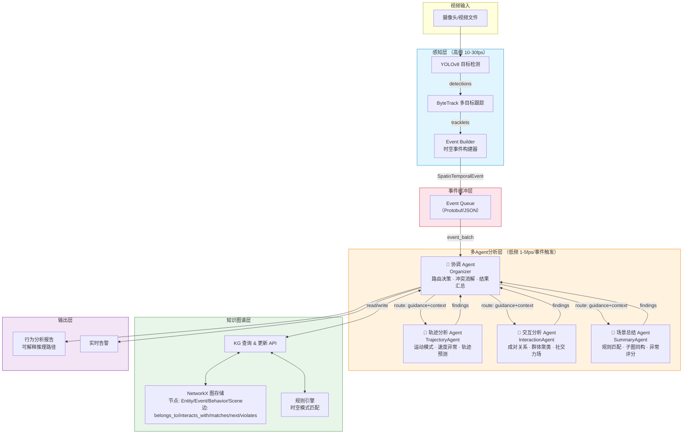
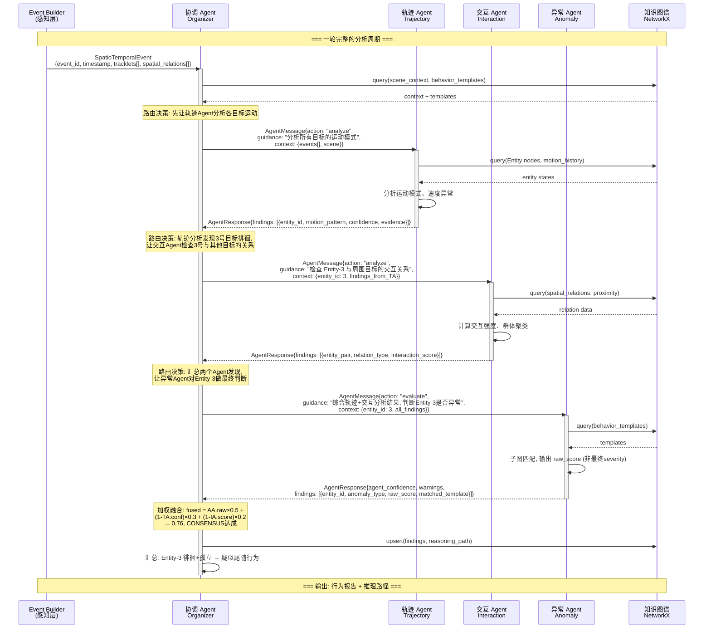
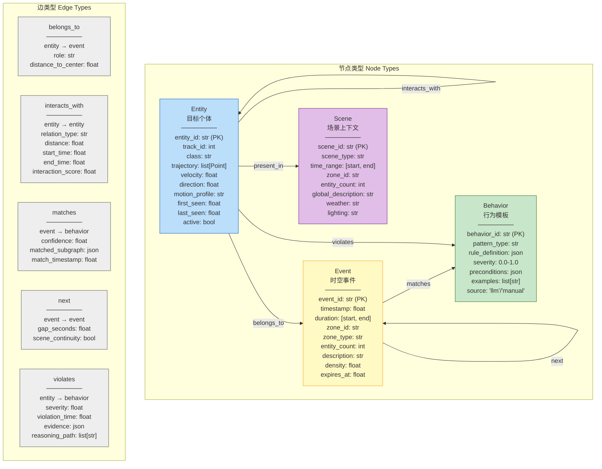

# YOLO + 多Agent协作 + KG 场景理解系统

## 1. 系统整体架构



### 3.1 KG API 操作定义

```python
# Agent 通过协调Agent调用的KG接口
class KGAPI:
    # 查询
    def query_nodes(node_type: str, filters: dict) -> list[Node]
    def query_edges(edge_type: str, filters: dict) -> list[Edge]
    def get_subgraph(node_ids: list[str], depth: int) -> nx.Graph
    def match_pattern(pattern_graph: nx.Graph) -> list[dict]  # 子图同构

    # 写入（由协调Agent统一执行）
    def upsert_node(node_id: str, node_type: str, properties: dict)
    def upsert_edge(from_id: str, to_id: str, edge_type: str, properties: dict)

    # 生命周期管理（TODO: 实现阶段处理）
    def evict_before(timestamp: float) -> int  # 清理 expires_at < timestamp 的Event节点
    def set_ttl(node_id: str, ttl_seconds: float)  # 设置节点过期时间
```

---


## 2. Agent 通信时序图



### 3.1 KG API 操作定义

```python
# Agent 通过协调Agent调用的KG接口
class KGAPI:
    # 查询
    def query_nodes(node_type: str, filters: dict) -> list[Node]
    def query_edges(edge_type: str, filters: dict) -> list[Edge]
    def get_subgraph(node_ids: list[str], depth: int) -> nx.Graph
    def match_pattern(pattern_graph: nx.Graph) -> list[dict]  # 子图同构

    # 写入（由协调Agent统一执行）
    def upsert_node(node_id: str, node_type: str, properties: dict)
    def upsert_edge(from_id: str, to_id: str, edge_type: str, properties: dict)

    # 生命周期管理（TODO: 实现阶段处理）
    def evict_before(timestamp: float) -> int  # 清理 expires_at < timestamp 的Event节点
    def set_ttl(node_id: str, ttl_seconds: float)  # 设置节点过期时间
```

---


## 3. KG Schema



### 3.1 KG API 操作定义

```python
# Agent 通过协调Agent调用的KG接口
class KGAPI:
    # 查询
    def query_nodes(node_type: str, filters: dict) -> list[Node]
    def query_edges(edge_type: str, filters: dict) -> list[Edge]
    def get_subgraph(node_ids: list[str], depth: int) -> nx.Graph
    def match_pattern(pattern_graph: nx.Graph) -> list[dict]  # 子图同构

    # 写入（由协调Agent统一执行）
    def upsert_node(node_id: str, node_type: str, properties: dict)
    def upsert_edge(from_id: str, to_id: str, edge_type: str, properties: dict)

    # 生命周期管理（TODO: 实现阶段处理）
    def evict_before(timestamp: float) -> int  # 清理 expires_at < timestamp 的Event节点
    def set_ttl(node_id: str, ttl_seconds: float)  # 设置节点过期时间
```

---


## 4. 接口协议定义

### 4.1 SpatioTemporalEvent（感知层 → Agent层）

```json
{
  "event_id": "Event-a1b2c3d4",
  "timestamp": 12.5,
  "duration": [12.0, 14.0],
  "frame_start": 300,
  "frame_end": 360,
  "fps": 30.0,
  "tracklets": [
    {
      "track_id": 3,
      "class": "person",
      "bbox": [120, 340, 200, 480],
      "centroid": [160, 410],
      "velocity_ms": 1.2,
      "direction_deg": 45.0,
      "trajectory": [[158,408,11.0], [159,409,11.5], [160,410,12.0]]
    }
  ],
  "spatial_relations": [
    {
      "track_1": 3,
      "track_2": 5,
      "distance_m": 2.3,
      "relation_type": "near",
      "duration_s": 5.0
    }
  ],
  "zone_id": "zone_A",
  "zone_type": "walkway"
}
```

| 字段 | 说明 |
|------|------|
| `frame_start` / `frame_end` | 事件覆盖的帧范围，差值 = 窗口帧数 |
| `fps` | 实际帧率，供 Agent 做时间换算。协调 Agent 据此判断窗口是否足够启动某类分析 |

### 4.2 AgentMessage（协调Agent → 分析Agent）

```json
{
  "message_id": "msg-x1y2z3",
  "sender": "organizer",
  "target_agent": "trajectory_agent",
  "timestamp": 12.5,
  "action": "analyze",
  "guidance": "分析 Entity-3 过去30秒的运动模式，该目标被识别为可能异常",
  "context": {
    "event_ids": ["Event-a1b2c3d4"],
    "focus_entities": ["Entity-3"],
    "previous_findings": [],
    "scene_type": "outdoor_plaza"
  }
}
```

### 4.3 AgentResponse（分析Agent → 协调Agent）

```json
{
  "message_id": "msg-r4s5t6",
  "sender": "trajectory_agent",
  "target": "organizer",
  "timestamp": 12.8,
  "agent_confidence": 0.85,
  "warnings": ["Entity-5 轨迹在 frame 120-135 段因遮挡缺失，数据不可靠"],
  "findings": [
    {
      "entity_id": "Entity-3",
      "finding_type": "motion_pattern",
      "value": "loitering",
      "confidence": 0.85,
      "evidence": [
        "mean_velocity 0.3m/s < threshold 0.5m/s for 30s",
        "direction_changes 7 in 10s > threshold 4"
      ],
      "kg_operations": [
        {
          "op": "upsert_node",
          "node_type": "Entity",
          "node_id": "Entity-3",
          "properties": {
            "motion_profile": "loitering",
            "last_analyzed": 12.8
          }
        }
      ]
    }
  ]
}
```

| 字段 | 说明 |
|------|------|
| `agent_confidence` | 该 Agent 对本轮整次分析的全局把握度（区别于单个 finding 的 confidence）。遮挡/数据不足时降低，协调 Agent 据此做权重衰减 |
| `warnings` | 数据质量告警列表，协调 Agent 在做冲突消解时参考（低 agent_confidence 的 Agent 意见降低权重） |

### 4.4 scene_report（协调Agent → 输出层）

```json
{
  "output_id": "out-k8l9m0",
  "timestamp": 13.0,
  "event_id": "Event-xxx",
  "duration": [12.0, 14.0],
  "frame_range": [300, 360],
  "scene_report": {
    "summary": "场景类型: outdoor_plaza，检测到 5 个目标。\n个体运动: ...\n交互关系: ...",
    "entity_count": 5,
    "motion_descriptions": [
      {"entity_id": "Entity-3", "description": "Entity-3 在过去 3.0s 内以低速移动...", "confidence": 0.85}
    ],
    "interaction_descriptions": [
      {"entities": ["Entity-3", "Entity-5"], "description": "Entity-3 与 Entity-5 间距 45px，共现 2.1s...", "confidence": 0.70}
    ]
  },
  "agent_summary": {
    "trajectory_agent_confidence": 0.85,
    "interaction_agent_confidence": 0.85,
    "summary_agent_confidence": 0.87
  },
  "kg_updates": [...]
}
```

| 字段 | 说明 |
|------|------|
| `status` | `consensus` / `stalemate` / `max_rounds` — 表示本轮分析的终止原因 |
| `rounds_used` | 实际使用的 Agent 调用轮数 |
| `fused_severity` | 协调 Agent 加权融合后的最终严重度，非任何单个 Agent 的输出 |
| `contributing_agents` | 每个 Agent 对最终分数的贡献及权重，实现可追溯融合 |
| `uncertain` | status 为 stalemate 时，无法确定的结果放入此列表 |

### 3.1 KG API 操作定义

```python
# Agent 通过协调Agent调用的KG接口
class KGAPI:
    # 查询
    def query_nodes(node_type: str, filters: dict) -> list[Node]
    def query_edges(edge_type: str, filters: dict) -> list[Edge]
    def get_subgraph(node_ids: list[str], depth: int) -> nx.Graph
    def match_pattern(pattern_graph: nx.Graph) -> list[dict]  # 子图同构

    # 写入（由协调Agent统一执行）
    def upsert_node(node_id: str, node_type: str, properties: dict)
    def upsert_edge(from_id: str, to_id: str, edge_type: str, properties: dict)

    # 生命周期管理（TODO: 实现阶段处理）
    def evict_before(timestamp: float) -> int  # 清理 expires_at < timestamp 的Event节点
    def set_ttl(node_id: str, ttl_seconds: float)  # 设置节点过期时间
```

---


## 5. Agent Prompt 模板设计

### 5.1 轨迹分析 Agent

```
你是轨迹分析专家。分析目标在过去时间窗口内的运动模式。

输入:
- 目标 {entity_id} 的轨迹历史: {trajectory}
- 场景上下文: {scene_type}

分析维度:
1. 运动模式分类: 直行 / 徘徊 / 停留 / 跑动 / 折返
2. 速度异常: 速度是否超出场景正常范围
3. 方向异常: 方向变化频率是否异常

输出 JSON 格式:
{"entity_id": "...", "motion_pattern": "...", "confidence": 0.0-1.0, "evidence": [...]}
```

### 5.2 交互分析 Agent

```
你是多智能体交互分析专家。分析目标之间在时空维度上的交互关系。

输入:
- 目标列表及其位置: {tracklets}
- 空间关系数据: {spatial_relations}

分析维度:
1. 成对关系: 跟随 / 靠近 / 远离 / 环绕 / 无交互
2. 群体聚类: 是否存在稳定的社交群体
3. 异常孤立: 是否有目标在所有群体之外

输出 JSON 格式:
{"interactions": [{"entity_pair": [id1,id2], "relation_type": "...", "score": 0.0-1.0}], "groups": [[ids]], "isolated": [ids]}
```

### 5.3 场景总结 Agent

```
你是行为异常检测专家。基于KG中的行为模板和规则，判断目标行为是否异常。

注意：你输出的是 raw_score（原始评分），不直接等于最终告警严重度。
最终 severity 由协调Agent 综合你的 raw_score + 轨迹Agent的 motion_pattern_confidence 
+ 交互Agent的 interaction_score 加权计算。

输入:
- 轨迹Agent发现: {trajectory_findings}
- 交互Agent发现: {interaction_findings}
- KG行为模板: {behavior_templates}

分析维度:
1. 子图匹配: 当前实体图与正常/异常行为模板的匹配度
2. 规则验证: 时空规则检查(如"walkway区域禁止停留超过60s")

输出 JSON 格式:
{"findings": [{"entity_id": "...", "anomaly_type": "...", "raw_score": 0.0-1.0, 
  "matched_template": "...", "matched_rule": "...", "evidence": [...]}]}
```

### 5.4 协调 Agent

## 6. 实现阶段 TODO

以下三项已在协议文档中预留定义，具体实现逻辑在编码阶段处理：

| # | 位置 | 内容 | 状态 |
|---|------|------|------|
| 3 | KG API | `evict_before(timestamp)` — 清理过期 Event 节点，防止 NetworkX 内存图无限增长。Event 节点构建时写入 `expires_at` | 📋 TODO |
| 4 | 场景总结 Agent | 输出 `raw_score`（原始子图匹配分），协调 Agent 做加权融合 → `fused_severity`。权重可配置 | 📋 TODO |
| 5 | 协调 Agent | 终止条件实现：CONSENSUS(confidence≥0.7且raw≤0.3或≥0.7) / STALEMATE(同entity 2轮未共识→uncertain) / MAX_ROUNDS(单事件≤3轮) | 📋 TODO |

```
你是多Agent系统的协调者。基于当前场景和各Agent的输入，做出路由决策和最终融合判断。

可用Agent:
- trajectory_agent: 分析个体运动模式
- interaction_agent: 分析目标间交互关系
- anomaly_agent: 提供原始异常评分

路由规则:
1. 优先让 trajectory_agent 分析所有新出现的目标
2. 如果有目标被标记为异常运动模式，路由到 interaction_agent
3. 如果交互分析发现异常关系，路由到 anomaly_agent 做原始评分
4. 收到 anomaly_agent 结果后，执行加权融合 → FINAL_ANSWER
5. 如果存在冲突，让相关Agent重新分析（附上不同意见）

终止条件:
- CONSENSUS: 各Agent的 confidence ≥ 0.7 且 异常Agent raw_score ≤ 0.3(正常) 或 ≥ 0.7(异常)
  满足时直接输出 FINAL_ANSWER
- STALEMATE: 同一 entity 已路由 2 轮仍无共识 → 标记为 uncertain 并输出，不做第三轮
- MAX_ROUNDS: 单个事件最多触发 3 轮 Agent 调用（任意组合），防止无限循环

加权融合规则 (Organizer Output):
fused_severity = anomaly_agent.raw_score × 0.5 
               + (1 - trajectory_agent.confidence_that_matches_raw_score) × 0.3
               + (1 - interaction_agent.interaction_score_if_isolated) × 0.2
各权重可调。最终 contributing_agents 记录每个Agent对最终分的贡献。

输出 JSON:
{"next": "agent_name | FINAL_ANSWER", "guidance": "...", "comment": "..."}
```
