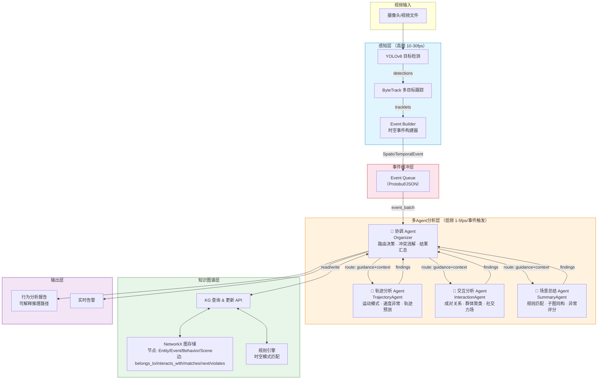
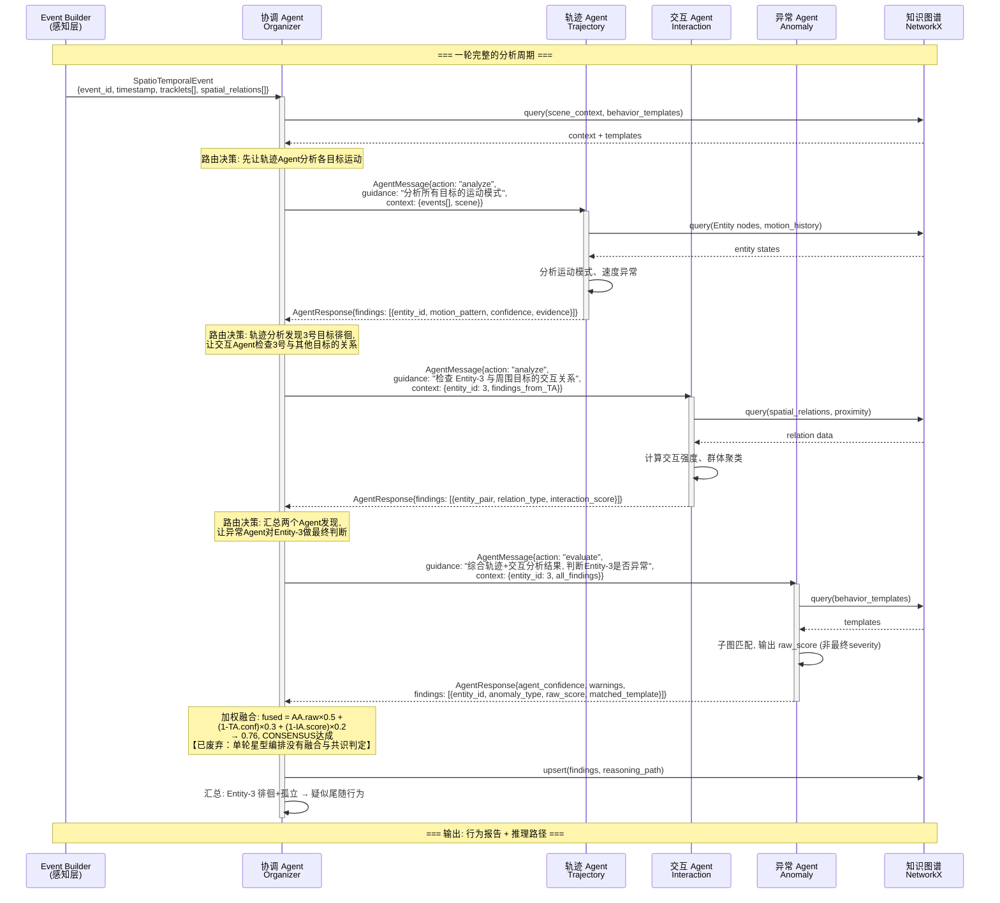
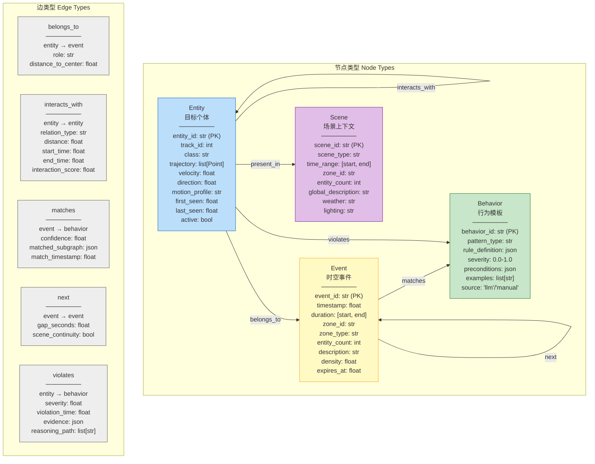

# YOLO + 多Agent协作 + KG 场景理解系统

## 1. 系统整体架构



## 2. Agent 通信时序图



## 3. KG Schema



### 3.1 KG API 操作定义

```python
# Agent 通过协调Agent调用的KG接口
class KGAPI:
    # 查询
    def query_nodes(node_type: str, filters: dict) -> list[Node]
    def query_edges(edge_type: str, filters: dict) -> list[Edge]
    def get_subgraph(node_ids: list[str], depth: int) -> nx.Graph
    def match_pattern(pattern_graph: nx.Graph) -> list[dict]  # 子图同构

    # 写入（由协调Agent统一执行）
    def upsert_node(node_id: str, node_type: str, properties: dict)
    def upsert_edge(from_id: str, to_id: str, edge_type: str, properties: dict)

    # 生命周期管理（TODO: 实现阶段处理）
    def evict_before(timestamp: float) -> int  # 清理 expires_at < timestamp 的Event节点
    def set_ttl(node_id: str, ttl_seconds: float)  # 设置节点过期时间
```

---


## 4. 接口协议定义

### 4.1 SpatioTemporalEvent（感知层 → Agent层）

```json
{
  "event_id": "Event-a1b2c3d4",
  "timestamp": 12.5,
  "duration": [12.0, 14.0],
  "frame_start": 300,
  "frame_end": 360,
  "fps": 30.0,
  "tracklets": [
    {
      "track_id": 3,
      "class": "person",
      "bbox": [120, 340, 200, 480],
      "centroid": [160, 410],
      "velocity_ms": 1.2,
      "direction_deg": 45.0,
      "trajectory": [[158,408,11.0], [159,409,11.5], [160,410,12.0]]
    }
  ],
  "spatial_relations": [
    {
      "track_1": 3,
      "track_2": 5,
      "distance_m": 2.3,
      "relation_type": "near",
      "duration_s": 5.0
    }
  ],
  "zone_id": "zone_A",
  "zone_type": "walkway"
}
```

| 字段 | 说明 |
|------|------|
| `frame_start` / `frame_end` | 事件覆盖的帧范围，差值 = 窗口帧数 |
| `fps` | 实际帧率，供 Agent 做时间换算。协调 Agent 据此判断窗口是否足够启动某类分析 |
| `velocity_ms` / `distance_m` | **单位是像素/秒与像素，不是米**。字段名沿用早期设想的物理单位，没有相机标定时只表示画面位移；dry-run 日志按 `px/s`、`px` 打印 |

### 4.2 AgentMessage（协调Agent → 分析Agent）

```json
{
  "message_id": "msg-x1y2z3",
  "sender": "organizer",
  "target_agent": "trajectory_agent",
  "timestamp": 12.5,
  "action": "analyze",
  "guidance": "分析 Entity-3 过去30秒的运动模式，该目标被识别为可能异常",
  "context": {
    "event_ids": ["Event-a1b2c3d4"],
    "focus_entities": ["Entity-3"],
    "previous_findings": [],
    "scene_type": "outdoor_plaza"
  }
}
```

### 4.3 AgentResponse（分析Agent → 协调Agent）

```json
{
  "message_id": "msg-r4s5t6",
  "sender": "trajectory_agent",
  "target": "organizer",
  "timestamp": 12.8,
  "agent_confidence": 0.85,
  "warnings": ["Entity-5 轨迹在 frame 120-135 段因遮挡缺失，数据不可靠"],
  "findings": [
    {
      "entity_id": "Entity-3",
      "finding_type": "motion_pattern",
      "value": "loitering",
      "confidence": 0.85,
      "evidence": [
        "mean_velocity 0.3m/s < threshold 0.5m/s for 30s",
        "direction_changes 7 in 10s > threshold 4"
      ],
      "kg_operations": [
        {
          "op": "upsert_node",
          "node_type": "Entity",
          "node_id": "Entity-3",
          "properties": {
            "motion_profile": "loitering",
            "last_analyzed": 12.8
          }
        }
      ]
    }
  ]
}
```

| 字段 | 说明 |
|------|------|
| `agent_confidence` | 该 Agent 对本轮整次分析的全局把握度（区别于单个 finding 的 confidence）。遮挡/数据不足时降低，协调 Agent 据此做权重衰减 |
| `warnings` | 数据质量告警列表，协调 Agent 在做冲突消解时参考（低 agent_confidence 的 Agent 意见降低权重） |

### 4.4 scene_report（协调Agent → 输出层）

```json
{
  "output_id": "out-k8l9m0",
  "timestamp": 13.0,
  "event_id": "Event-xxx",
  "duration": [12.0, 14.0],
  "frame_range": [300, 360],
  "scene_report": {
    "summary": "场景类型: outdoor_plaza，检测到 5 个目标。\n个体运动: ...\n交互关系: ...",
    "entity_count": 5,
    "motion_descriptions": [
      {"entity_id": "Entity-3", "description": "Entity-3 在过去 3.0s 内以低速移动...", "confidence": 0.85}
    ],
    "interaction_descriptions": [
      {"entities": ["Entity-3", "Entity-5"], "description": "Entity-3 与 Entity-5 间距 45px，共现 2.1s...", "confidence": 0.70}
    ]
  },
  "agent_summary": {
    "trajectory_agent_confidence": 0.85,
    "interaction_agent_confidence": 0.85,
    "summary_agent_confidence": 0.87
  },
  "kg_updates": [...]
}
```

| 字段 | 说明 |
|------|------|
| `status` | 【已废弃】`consensus` / `stalemate` / `max_rounds` — 早期多轮协商的终止原因，当前单轮编排不产出 |
| `rounds_used` | 【已废弃】实际使用的 Agent 调用轮数 |
| `fused_severity` | 【已废弃】协调 Agent 加权融合后的最终严重度，非任何单个 Agent 的输出 |
| `contributing_agents` | 【已废弃】每个 Agent 对最终分数的贡献及权重，实现可追溯融合 |
| `uncertain` | 【已废弃】status 为 stalemate 时，无法确定的结果放入此列表 |

## 5. Agent Prompt 模板设计

### 5.1 轨迹分析 Agent

```
你是轨迹分析专家。分析目标在过去时间窗口内的运动模式。

输入:
- 目标 {entity_id} 的轨迹历史: {trajectory}
- 场景上下文: {scene_type}

分析维度:
1. 运动模式分类: 直行 / 徘徊 / 停留 / 跑动 / 折返
2. 速度异常: 速度是否超出场景正常范围
3. 方向异常: 方向变化频率是否异常

输出 JSON 格式:
{"entity_id": "...", "motion_pattern": "...", "confidence": 0.0-1.0, "evidence": [...]}
```

### 5.2 交互分析 Agent

```
你是多智能体交互分析专家。分析目标之间在时空维度上的交互关系。

输入:
- 目标列表及其位置: {tracklets}
- 空间关系数据: {spatial_relations}

分析维度:
1. 成对关系: 跟随 / 靠近 / 远离 / 环绕 / 无交互
2. 群体聚类: 是否存在稳定的社交群体
3. 异常孤立: 是否有目标在所有群体之外

输出 JSON 格式:
{"interactions": [{"entity_pair": [id1,id2], "relation_type": "...", "score": 0.0-1.0}], "groups": [[ids]], "isolated": [ids]}
```

### 5.3 场景总结 Agent

```
你是行为异常检测专家。基于KG中的行为模板和规则，判断目标行为是否异常。

注意：你输出的是 raw_score（原始评分），不直接等于最终告警严重度。
最终 severity 由协调Agent 综合你的 raw_score + 轨迹Agent的 motion_pattern_confidence 
+ 交互Agent的 interaction_score 加权计算。

输入:
- 轨迹Agent发现: {trajectory_findings}
- 交互Agent发现: {interaction_findings}
- KG行为模板: {behavior_templates}

分析维度:
1. 子图匹配: 当前实体图与正常/异常行为模板的匹配度
2. 规则验证: 时空规则检查(如"walkway区域禁止停留超过60s")

输出 JSON 格式:
{"findings": [{"entity_id": "...", "anomaly_type": "...", "raw_score": 0.0-1.0, 
  "matched_template": "...", "matched_rule": "...", "evidence": [...]}]}
```

### 5.4 协调 Agent

> ⚠️ **本节已废弃**：这是早期「多轮协商」设计的草稿。终止条件 CONSENSUS / STALEMATE / MAX_ROUNDS
> 与 `fused_severity` 加权融合都**没有实现**——`Orchestrator` 后来改成单轮星型编排（每个事件里每个
> Agent 各跑一次，见第 6 节）。这段 prompt 也没有被送进模型。

```
你是多Agent系统的协调者。基于当前场景和各Agent的输入，做出路由决策和最终融合判断。

可用Agent:
- trajectory_agent: 分析个体运动模式
- interaction_agent: 分析目标间交互关系
- anomaly_agent: 提供原始异常评分

路由规则:
1. 优先让 trajectory_agent 分析所有新出现的目标
2. 如果有目标被标记为异常运动模式，路由到 interaction_agent
3. 如果交互分析发现异常关系，路由到 anomaly_agent 做原始评分
4. 收到 anomaly_agent 结果后，执行加权融合 → FINAL_ANSWER
5. 如果存在冲突，让相关Agent重新分析（附上不同意见）

终止条件（【已废弃】未实现）:
- CONSENSUS: 各Agent的 confidence ≥ 0.7 且 异常Agent raw_score ≤ 0.3(正常) 或 ≥ 0.7(异常)
  满足时直接输出 FINAL_ANSWER
- STALEMATE: 同一 entity 已路由 2 轮仍无共识 → 标记为 uncertain 并输出，不做第三轮
- MAX_ROUNDS: 单个事件最多触发 3 轮 Agent 调用（任意组合），防止无限循环

加权融合规则（【已废弃】未实现）:
fused_severity = anomaly_agent.raw_score × 0.5 
               + (1 - trajectory_agent.confidence_that_matches_raw_score) × 0.3
               + (1 - interaction_agent.interaction_score_if_isolated) × 0.2
各权重可调。最终 contributing_agents 记录每个Agent对最终分的贡献。

输出 JSON:
{"next": "agent_name | FINAL_ANSWER", "guidance": "...", "comment": "..."}
```

> **Prompt 模板现状**：`agents/prompts/` 下现在只剩 `interaction.md` 一个文件，而且真的接上了——
> `interaction_agent._llm_classify_pair` 用 `self.system_prompt`（即它的内容）作为 system prompt。
> 另外四个模板（trajectory / summary / anomaly / orchestrator）对应的 Agent 根本不调模型，
> 已随这轮清理删除；`trajectory_agent._llm_refine()` 同属零调用死代码，也已删除。
> 因此本节（以及 5.1–5.3）里描述的多 Agent prompt 协商仍只是设计文档，不是实际输入。

## 6. 实现阶段清单

以下是协议文档里预留、后来逐个落地的情况。**三项里两项已实现**；第三项（多轮协商的终止条件）没有实现，因为最终架构不是多轮协商，而是单轮星型编排——见本节末尾说明。

| # | 位置 | 内容 | 状态 |
|---|------|------|------|
| 3 | KG API | `evict_before(timestamp)` — 清理过期 Event 节点，防止 NetworkX 内存图无限增长。Event 节点构建时写入 `expires_at` | ✅ 已实现（`kg/graph_store.py:184`，`pipeline.py:416` 每个事件后调用） |
| 4 | 异常检测 Agent | 输出 `raw_score`（原始子图匹配分），最终 `fused_severity` 由总结层加权融合 | ✅ 已实现（`agents/anomaly_agent.py`，`raw_score` 与 `confidence` 一并输出） |
| 5 | 协调 Agent | 多轮协商的终止条件：CONSENSUS / STALEMATE / MAX_ROUNDS | ⛔ 未实现，且**架构已改为单轮星型编排** —— `Orchestrator.process_event` 按注册顺序让每个 Agent 各跑一次，收集结果后交总结层，没有「轮次」概念。多轮协商需要 Agent 之间互相看结果并重新提问，那是另一套架构；当前设计选择单轮，代价是复杂冲突不会二次求证 |

> 第 5 项不是「忘了做」，是设计变了：单轮星型编排在事件级吞吐上更稳（每个事件固定 N 次 Agent 调用，可预测），代价是遇到互相矛盾的判断时不会追问。如果要支持多轮，需要在 `Orchestrator` 里加轮次控制与终止判定，并让 Agent 的 `think()` 能接收其它 Agent 的结论。

## 7. 实现要点与推导

> 主页只保留结论，这一节记录配置常量、阈值来源与取舍推导，和源码一一对应。

### 7.1 跟踪：GMC、卡尔曼、ReID 与组合距离

- **GMC**：相邻帧用 `goodFeaturesToTrack` 取稀疏角点，`calcOpticalFlowPyrLK` 跟踪，RANSAC 拟合 2×3 仿射，把背景整体位移从卡尔曼预测里扣掉。手持、云台或轻微抖动的画面里，没有这一步，静止行人会被算成高速移动。
- **卡尔曼**：8 状态 `(cx, cy, w, h, vx, vy, vw, vh)`，4 维观测（中心点 + 宽高）；轨迹丢失后靠预测位置维持，`lost_track_buffer=120` 帧后才丢弃。
- **ReID**：OSNet x0.25（MSMT17 预训练）输出 512 维 L2 归一化特征。BoxMOT 与 torchreid 两条链路，本地 `models/osnet_x0_25_msmt17.pt` 优先；都不可用时回退 ImageNet ResNet18，ID 连续性明显变差。
- **组合距离**：先算 `1 - IoU`；IoU < 0.5 的配对不看外观，外观余弦距离 > 0.25 直接置 1；两者取 `min` 作为匈牙利代价。外观只在「位置还说得过去」的候选内部做区分，不全局找人，避免同款工服、相似身高的人串号。
- **低分框阶段**：遮挡后重现的人往往只剩低分检测，第二阶段只用 IoU（阈值 0.5）。此处加入外观会引入错误关联，恢复率反而下降。

### 7.2 实体合并：三项证据

- 打分：0.35 × 位置 + 0.30 × 时间 + 0.35 × 外观；≥0.72 自动合并，0.30–0.72 记为 tentative 候选并逐帧累积证据。
- 位置分取「最后位置」和「按速度外推位置」中更近的那个；`pipeline.py` 启动时把位置门限抬到画面宽的 40%，否则 1920 画面里跨几秒遮挡的位移会被判成新实体。
- 时间分允许 300 帧 gap；外观余弦 > 0.90 时可突破上限，用于立柱、货架后的长时间遮挡。
- 合并证据写进实体档案（`merge_evidence`），供 Web 与 KG 回溯。

### 7.3 事件窗口

- CLI 每 30 帧（`--event-interval`）切一个 `SpatioTemporalEvent`；Web 后台固定 60 帧，为交互流畅让路。
- 窗口内 tracklet 按 `track_id` 去重，保留轨迹最全的一条；计算 100 像素内的 `near` 空间关系。
- 事件既是 Agent 的输入粒度，也是 KG 的 Event 节点来源；后 20 帧凑不满一个窗口时不会补一个短事件。

### 7.4 编排与 LLM 参与度

- 单轮星型编排：中心按 `trajectory → interaction → summary` 串行路由，每步把前序 findings 塞进下一步上下文；结束后统一收集 `kg_operations` 写 GraphStore。
- 选星型而非链式：链式 A→B→C 里 C 只看得到 B，想加维度就得改链路；星型中心持有全部 responses，Agent 只依赖传入 context，可单独替换或追加（`--with-anomaly` 就是这样插到 `summary` 之前的）。
- 四个 Agent 中只有 `interaction_agent` 会调 LLM：规则置信度 < 0.60 时调一次 `chat_with_json_output`，且只在 LLM 置信度更高时覆盖规则结论；prompt 来自 `agents/prompts/interaction.md`。
- `trajectory_agent` 是纯规则 / 分位数，`summary_agent` 是字符串模板，`anomaly_agent` 是关键词模板打分，都不调模型。
- `/chat` 的规则模板匹配不上时，才把实体摘要发给 LLM；前端「待确认合并」发的 `__merge__` 只在前端状态完成，不落库。

### 7.5 知识图谱与规则引擎

- `kg/graph_store.py`：NetworkX DiGraph，属性统一 JSON 编解码，支持 upsert、子图、VF2 子图匹配、GraphML 存取；Event 节点带 `expires_at`，可按时间批量淘汰。
- `kg/continuity.py`：写 Event / Entity 与 `belongs_to`、`interacts_with`、`next` 边；同一对实体的交互边按事件聚合，保留最近 20 条证据，`confidence = min(1, 事件数 / 5)`，`duration` 由证据累加。
- `kg/rule_engine.py`：按 `zone_type`、`motion_profile`、速度区间、停留时长、方向变化逐实体检查；内置徘徊 > 60 秒、奔跑、静止 > 120 秒三条规则，依赖 Entity 的 `motion_profile` / `velocity` / `direction_change_count` / `first_seen` / `class` 字段。
- `pipeline.py --with-rules` 在 Agent 写完后调用 `RuleEngine.check_all()`，命中结果挂在 `output["rule_hits"]` 并打印。
